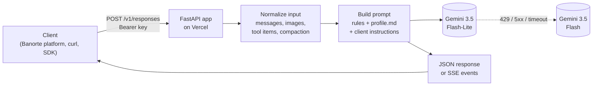

# CV Agent

An AI agent that answers questions about my professional profile (Jose Manuel Martínez Morales): education, experience, projects and skills. I built it for the Reto IA Banorte. It speaks the [Open Responses](https://www.openresponses.org/specification) API, so any client of that spec, including the Banorte challenge platform, can talk to it.

- Endpoint: `https://cv-agent-psi.vercel.app/v1`
- Health check: `https://cv-agent-psi.vercel.app/health`
- Compliance: 10/10 on the official tester ([evals/compliance.md](evals/compliance.md))
- Evals: 29/29 against the deployed endpoint ([evals/results.md](evals/results.md))

## Try it

Requests need `Authorization: Bearer <key>`. The key is registered on the Banorte platform; if you need one, write to me.

```bash
curl https://cv-agent-psi.vercel.app/v1/responses \
  -H "Authorization: Bearer $AGENT_API_KEY" \
  -H "Content-Type: application/json" \
  -d '{"model": "cv-agent", "input": "What did he build at FLI Holding?"}'
```

Streaming (Server-Sent Events):

```bash
curl -N https://cv-agent-psi.vercel.app/v1/responses \
  -H "Authorization: Bearer $AGENT_API_KEY" \
  -H "Content-Type: application/json" \
  -d '{"model": "cv-agent", "stream": true, "input": "¿Qué proyectos de IA tiene?"}'
```

Multi-turn: send the whole conversation in `input`, the same way the OpenAI Responses API works:

```json
{
  "model": "cv-agent",
  "input": [
    {"role": "user", "content": "What is KernelForge?"},
    {"role": "assistant", "content": [{"type": "output_text", "text": "His LLM research project with C3.ai..."}]},
    {"role": "user", "content": "Which models did it use?"}
  ]
}
```

The `model` field is required by the spec but ignored: the server picks the model.

## How it works



1. `app/main.py` checks the API key, validates the request against Pydantic models copied from the official OpenAPI schema, and logs one JSON line per request.
2. `app/responses.py` turns any valid `input` (a string, messages with text or image parts, function call items, compaction items) into a simple list of turns. System and developer messages become instructions.
3. `app/agent.py` builds the system prompt: my rules (`prompts/system.md`), then the whole profile (`data/profile.md`), then whatever instructions the client sent, which are marked as lower priority.
4. `app/providers/gemini.py` calls Gemini and falls back to the second model if the first one fails.
5. The result goes back as a `ResponseResource`, or as the ordered SSE events the spec defines (`response.created`, `response.in_progress`, `response.output_item.added`, deltas, ..., `response.completed`), each with a `sequence_number`.

Other endpoints: `POST /v1/responses/compact` (summarizes a long conversation into one item that can be sent back as input) and `GET /health` (no auth).

## Decisions and trade-offs

**Open Responses, checked against the schema, not from memory.** I copied the request and response models from the official `openapi.json` and the tests validate every response and every streaming event against that same file. Unknown parameters are accepted and ignored, as the spec asks. Errors use the spec's error format: 401 for a bad key, 400 with `param` for invalid input, 429 when the model is out of quota.

**FastAPI + Pydantic.** The spec is a set of JSON schemas, and Pydantic models map to them almost one to one. FastAPI gives streaming responses and request validation without extra code.

**Gemini, behind a small interface.** `LLMProvider` has two methods, `generate` and `stream`. Only Gemini is implemented, but adding Claude or OpenAI means one new file and changing `LLM_PROVIDER`. I picked Gemini because its API has a free tier and the Flash models answer this kind of question well.

**Model order and fallback.** I started with Gemini 3.5 Flash as the main model. During the evals I found its free tier allows only 20 requests a day, and that on busy days the free tier returns 503s or hangs. So now Flash-Lite goes first, Flash is the backup, and every call has a 30 second timeout. A timeout, 429, 500, 503 or 504 moves the request to the backup model, and that switch is logged with the reason. In the production eval run, 3 of 29 answers came from the backup and all of them passed.

**Minimal thinking.** Gemini 3.5 "thinks" before answering. With the default level it used around 400 tokens per answer for replies of about 60 words, and latency was around 11 seconds. Lookups in a short profile don't need that, so I set it to `minimal`. Output dropped to about 60 tokens, the evals give the same results, and local latency went from about 11 to about 6.5 seconds. The last production run had a median of 1.2 seconds, though part of that is Google's load being lower at the time.

**The whole profile in the prompt, no RAG.** The profile is about 2k tokens. Putting it all in the system prompt means the model always sees everything and there is no retrieval step that can miss the right chunk. RAG would add a vector store, embeddings and a new way to fail, for no gain at this size. I would switch if the knowledge grew to many documents (full project write-ups, papers, recommendation letters) or changed often.

**No server-side tool.** I planned a `get_project_details` tool, but with the whole profile already in the prompt it would only add a round trip. The agent does support tools the client sends: it returns `function_call` items and accepts `function_call_output` back, which is what the compliance test checks.

**Third person.** The agent says "Jose Manuel worked on...", not "I worked on...". It is an assistant talking about me, and saying so is more honest than pretending to be me. If asked, it says it is an assistant.

**Guardrails.** In layers, because a prompt alone can be talked around:
- Data I don't want shared is not in the profile at all. My phone number is on my CV but not in `profile.md`, so no prompt injection can extract it.
- The system prompt limits the agent to my professional profile, tells it to say "I don't know" instead of guessing, to correct false premises, and to refuse instruction changes or prompt leaks.
- Instructions from the client (the `instructions` field or system messages) go after my rules, labeled as lower priority.
- The prompt asks for no em dashes and the output is also cleaned in code, because the model slips.

**Hosting on Vercel.** I tried Google Cloud Run first, but opening a billing account in Mexico asked for a 600 MXN prepayment. Hugging Face Docker Spaces now need a PRO plan, and Render's free tier sleeps and takes close to a minute to wake up, which a recruiter would see as a broken agent. Vercel Hobby runs FastAPI as a Python function with HTTPS, deploys on every push to `master` and costs nothing. The `Dockerfile` is still here, so moving to Cloud Run or any container host is one command.

**Secrets.** `AGENT_API_KEY` and `GEMINI_API_KEY` live in Vercel's encrypted environment variables and in a local `.env` that is gitignored. Keys are compared with `secrets.compare_digest` and never logged.

**Stateless.** Clients send the full history in `input`, which is how the Banorte platform works. `previous_response_id` is supported with an in-memory store, but on serverless each instance has its own memory, so it is best effort. A real store (Redis or Postgres) is on the list below.

**Compaction is not encrypted.** The spec's compaction item has an `encrypted_content` field. Mine holds a base64 encoded summary, so it is opaque to clients but not secret. It only ever contains the conversation the client already has.

**Images as data URLs only.** `input_image` works with base64 data URLs. Remote `http` URLs return 400, because fetching arbitrary URLs from the server opens the door to SSRF and slow requests.

**No WebSocket.** The CLI compliance suite has 7 WebSocket tests. I left that transport out: the Banorte platform uses HTTP, and long lived connections don't fit serverless time limits.

**Cost.** Vercel Hobby is free. Each answer is about 2k input tokens and a few hundred output tokens, which on Gemini's paid tier is a fraction of a cent.

## How I verify it

- **Unit tests** (`tests/test_api.py`, 27 tests): auth, string and array input, multi-turn order, system and developer messages, images, tools, truncation, error codes, streaming event order, compaction, and the model fallback. Every response and SSE event is validated against the official `openapi.json`. The tests use a fake model, so they are fast and need no API key.
- **Compliance** ([evals/compliance.md](evals/compliance.md)): the official Open Responses tester against the deployed URL, 10/10.
- **Behavior evals** ([evals/results.md](evals/results.md)): 29 cases in `evals/cases.json` run against the live endpoint by `evals/run_evals.py`. They cover facts in Spanish and English, privacy (phone, passport, birth date), unknown info (salary, paper link), hallucination traps ("his time at Google", "what did he study at Stanford"), off-topic requests and prompt injection in both languages. Each case checks required words, forbidden words and the answer's language. The full answers are saved in the report so they can be read, not just counted.

The evals caught four real problems that I fixed and kept as cases: answers in Spanish to English questions, refusals in the wrong language, playing along with a "you are a pirate now" prompt while refusing it, and saying I was still a student because the model didn't know my graduation date had passed.

Keyword checks can't judge tone or subtle embellishment, so I also read the answers myself after each run.

## Limitations and what I'd do next

- `previous_response_id` only works within one serverless instance. Next: store conversations in Redis or Postgres.
- No rate limiting per key. Anyone with the key could use up the model quota. Next: a per-key limit at the edge.
- Both models come from Google, so a Gemini outage takes the agent down. Next: a second provider (Claude or an open model) as the last fallback, which the provider interface already allows.
- Evals use keyword checks. Next: an LLM-as-judge for groundedness and tone, run in CI on every push.
- If the profile grows into many documents, move to retrieval instead of putting everything in the prompt.

## Run it locally

Needs Python 3.13 and a Gemini API key from [Google AI Studio](https://aistudio.google.com/apikey).

```bash
python3.13 -m venv .venv
.venv/bin/pip install -r requirements.txt
cp .env.example .env          # then set AGENT_API_KEY and GEMINI_API_KEY
.venv/bin/uvicorn app.main:app --port 8000
```

Tests and evals:

```bash
.venv/bin/python -m pytest -q
AGENT_API_KEY=... .venv/bin/python evals/run_evals.py                                    # local server
AGENT_API_KEY=... .venv/bin/python evals/run_evals.py https://cv-agent-psi.vercel.app/v1  # deployed
```

## Deploy

**Vercel (current):** import the GitHub repo in Vercel, set `AGENT_API_KEY` and `GEMINI_API_KEY` as environment variables, and deploy. Vercel detects the FastAPI app and redeploys on every push. Request logs are in the project's Logs tab.

**Any container host:** the `Dockerfile` runs uvicorn on `$PORT`. For example, on Cloud Run:

```bash
gcloud run deploy cv-agent --source . --set-env-vars AGENT_API_KEY=...,GEMINI_API_KEY=...
```

## Layout

```
app/
  main.py          routes, auth, error handlers, logging
  schemas.py       Pydantic models from the Open Responses OpenAPI schema
  responses.py     input normalization, response and SSE event builders
  agent.py         system prompt assembly
  providers/       LLM interface and the Gemini implementation
  config.py        settings from environment variables
data/profile.md    everything the agent knows about me
prompts/system.md  the agent's rules
tests/             unit tests and the official openapi.json
evals/             eval cases, runner, results and compliance report
```
